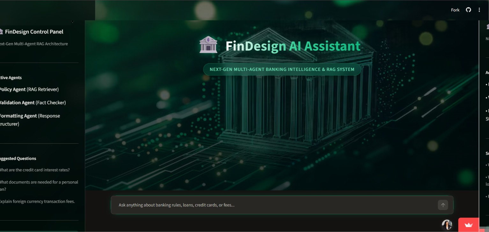
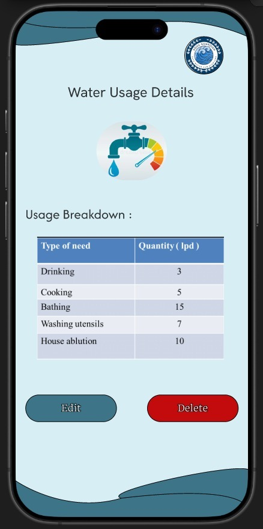
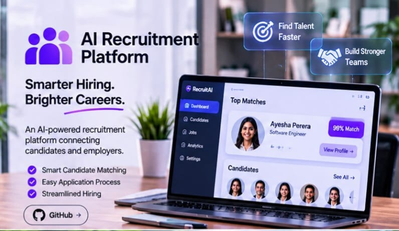
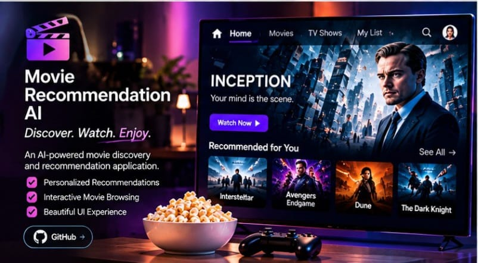

# Hi, I'm Harshani Medhavi! 

### Software Engineering Undergraduate | Aspiring UI/UX Designer | Frontend Developer

Welcome to my personal portfolio repository! I'm a Software Engineering undergraduate passionate about building creative digital experiences, designing user-friendly interfaces, and exploring innovative technologies.

I enjoy combining creativity with technology to develop meaningful projects and continuously improve my technical skills.

---

##  About Me

-  BSc (Hons) in Software Engineering – Horizon Campus
-  Interested in UI/UX Design and Graphic Design
-  Learning and building projects in Frontend Development
-  Interested in Artificial Intelligence and modern technologies
-  Always learning and improving my skills
-  Currently looking for internship opportunities

---

##  Skills & Technologies

**Programming & Development**
- HTML
- CSS
- JavaScript
- React
- Java
- Python

**Design Tools**
- Figma
- Canva

**Other Tools**
- Git
- GitHub
- Visual Studio Code

---

##  Featured Projects

### 1. FinDesign AI Assistant
An AI-powered banking marketing assistant designed to support creative campaign planning, content generation, and compliance-focused workflows.

**Technologies:** Python, LangChain, RAG, ChromaDB, Groq, Claude, Streamlit

### 2. AquaGuardian – Water Management App
A team project focused on water management and quality awareness. My contribution focuses on the Water Quality Map module and its user interface.

**Focus:** UI/UX Design, Water Quality Map

### 3. BrewBloom – Brand Identity Design
A creative branding concept for a coffee brand, exploring visual identity, logo design, colours, and brand presentation.

**Focus:** Graphic Design, Branding, Visual Identity

### 4. AI Recruitment Platform
A group project developing a platform that connects candidates and employers through an AI-powered recruitment experience.

**My Role:** Frontend Developer  
**Technologies:** React, JavaScript, HTML, CSS

[View Project on GitHub](https://github.com/Thilini-samanthika/AI-Recruitment-Platform)

### 5. Movie Recommendation AI
A group project focused on an AI-powered movie discovery and recommendation experience.

**My Role:** Frontend Developer  
**Technologies:** React, JavaScript, HTML, CSS

[View Project on GitHub](https://github.com/Thilini-samanthika/Movie-recommendation-ai)

---

##  Education

**BSc (Hons) in Software Engineering**  
Horizon Campus

**Diploma in Information Technology**  
ICBT Campus

**Diploma in English**  
ICBT Campus

---

##  Connect With Me

- **GitHub:** [harshanimedhavi-create](https://github.com/harshanimedhavi-create)
- **LinkedIn:** [Harshani Medhavi](https://www.linkedin.com/in/harshani-medhavi-09075434b/)

---

##  My Goal

My goal is to grow as a technology professional, gain practical industry experience, and create digital solutions that combine functionality, creativity, and great user experiences.

**Thank you for visiting my portfolio!** 
